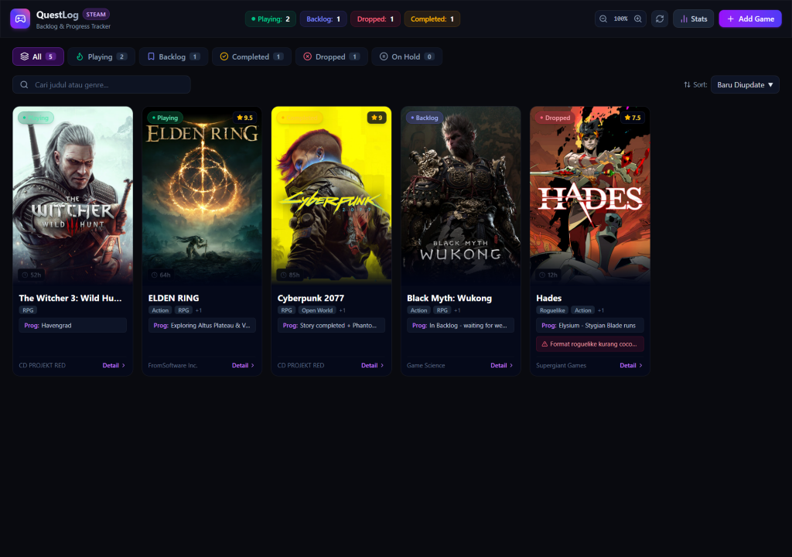
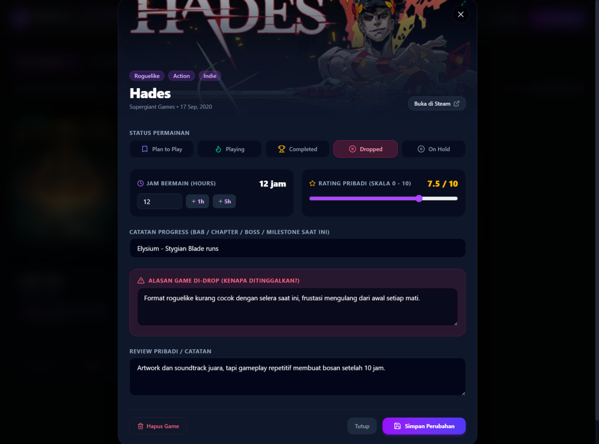

# 🎮 QuestLog

> **Personal Game Backlog & Progress Tracker with Real-Time Steam API Integration**

[](https://www.typescriptlang.org/)
[](https://react.dev/)
[](https://vitejs.dev/)
[](https://tailwindcss.com/)
[](https://store.steampowered.com/)
[](LICENSE)

**QuestLog** adalah aplikasi desktop modern untuk mencatat, mengatur, dan memantau progres game yang sedang kamu mainkan (*Playing*), rencana game yang ingin dimainkan (*Backlog / Plan to Play*), game yang sudah tamat (*Completed*), serta game yang kamu putuskan untuk berhenti mainkan (**_Dropped_**) beserta alasan spesifiknya.

Aplikasi ini terhubung langsung ke **Steam Store API & Steam CDN** untuk menarik cover poster vertikal resolusi tinggi (`600x900`), banner header, genre, pengembang, tanggal rilis, dan skor Metacritic secara instan.

---

## 📸 Preview Tampilan

| Dashboard Utama | Detail Game & Alasan Drop |
| :---: | :---: |
|  |  |
| *Dashboard katalog game dengan status visual, jam main & rating* | *Modal detail game: pelacak progress, rating, dan alasan game di-drop* |

---

## ✨ Fitur Utama

- 🔍 **Real-Time Steam Search & Auto-Fetch Artwork**:
  - Cukup ketik judul game di modal pencarian.
  - Otomatis menarik poster vertikal resmi Steam Library (`library_600x900.jpg`), banner horizontal (`header.jpg`), pengembang, genre, dan tanggal rilis.
  - Mendukung input manual untuk game non-Steam / konsol (PlayStation, Nintendo Switch, Xbox).

- 🏷️ **Kategorisasi Status Lengkap**:
  - **Playing**: Game yang sedang aktif dimainkan (dilengkapi badge animasi *pulse*).
  - **Plan to Play (Backlog)**: Antrean game yang siap dimainkan.
  - **Completed**: Game yang berhasil ditamatkan (dengan efek animasi selebrasi *confetti* saat tamat 🎉).
  - **Dropped**: Game yang kamu tinggalkan, dilengkapi **Catatan Alasan Drop** khusus agar kamu ingat di masa depan kenapa game tersebut tidak dilanjutkan.
  - **On Hold**: Game yang sedang rehat/diistirahatkan sementara.

- ⏱️ **Pelacak Progres & Jam Bermain**:
  - Catat bab/chapter, milestone quest, atau persentase jalan cerita saat ini.
  - Tombol instan penambah waktu main (+1 Jam, +5 Jam).
  - Skala rating pribadi (0 – 10).
  - Catatan personal & ulasan bebas untuk build karakter atau impresi.

- 📊 **Statistik & Analisis Perpustakaan**:
  - Total game yang tersimpan, total jam bermain (*playtime*), rata-rata rating pribadi, dan persentase *completion rate*.

- 🖥️ **Pengalaman Desktop Native & Windows Shortcut**:
  - Dilengkapi shortcut desktop 1-klik (`QuestLog.lnk`) di Desktop Windows.
  - Berjalan sebagai jendela desktop mandiri tanpa address bar atau tabs browser.
  - Sangat hemat memori (RAM) dibandingkan Electron berkat arsitektur lokal yang ramping.

- 💾 **Cadangan & Pemulihan Data (Backup & Recovery)**:
  - **Ekspor Mandiri**: Unduh salinan database katalog game dalam format JSON sekali klik untuk dipindahkan ke PC lain atau disimpan di cloud drive.
  - **Impor & Pemulihan**: Pulihkan data backup dengan opsi *Replace* (mengganti seluruh data) atau *Merge* (menggabungkan data tanpa menghapus yang ada).
  - **Snapshot Otomatis Lokal**: Sistem otomatis mencatat snapshot cadangan di PC sebelum perubahan besar dilakukan, memungkinkan pemulihan instan jika terjadi kesalahan.

- 💾 **Data Milik Sendiri (Offline-First)**:
  - Seluruh data game tersimpan rapi dan aman di komputer kamu sendiri (`data/games.json`), tanpa ketergantungan pada server pihak ketiga.

---

## 🛠️ Tech Stack

| Komponen | Teknologi |
| :--- | :--- |
| **Frontend** | React 19, TypeScript, Vite 8 |
| **Styling** | Tailwind CSS v4, Lucide React Icons |
| **Backend & API** | Node.js (Built-in HTTP & File System, tanpa native C++ compile) |
| **Integrasi** | Steam Store Search API, Steam AppDetails API, Steam Akamai CDN |
| **Animasi** | Canvas Confetti, CSS Glassmorphism |
| **Database** | Local JSON File Storage (`data/games.json`) |

---

## 🚀 Panduan Memulai (Quick Start)

### Prasyarat
- [Node.js](https://nodejs.org/) (versi 18 ke atas disarankan)
- [Git](https://git-scm.com/)

### 1. Clone Repository
```bash
git clone https://github.com/RakaPanduAulia/QuestLog.git
cd QuestLog
```

### 2. Install Dependensi
```bash
npm install
```

### 3. Build & Jalankan Aplikasi
```bash
# Build frontend
npm run build

# Jalankan server
npm start
```
Buka browser di `http://localhost:3001` atau jalankan file **`QuestLog.bat`** untuk membuka langsung dalam mode aplikasi desktop.

---

## 📂 Struktur Proyek

```text
QuestLog/
├── data/
│   └── games.json           # Database lokal penyimpanan game
├── screenshots/
│   └── preview.png          # Screenshot aplikasi untuk dokumentasi
├── src/
│   ├── components/
│   │   ├── AddGameModal.tsx     # Modal pencarian Steam & input game
│   │   ├── GameCard.tsx         # Kartu poster game dengan status & hover glow
│   │   ├── GameDetailModal.tsx  # Modal detail game, edit progress & alasan drop
│   │   ├── Navbar.tsx           # Navigasi atas & ringkasan status realtime
│   │   ├── StatsModal.tsx       # Modal analitik & statistik perpustakaan
│   │   └── StatusTabs.tsx       # Filter kategori status, search & sorting
│   ├── services/
│   │   └── api.ts               # Klien API frontend
│   ├── types/
│   │   └── game.ts              # Type definitions TypeScript
│   ├── App.tsx                  # Root Application Component
│   ├── index.css                # Styling Tailwind CSS & Glassmorphism
│   └── main.tsx                 # React DOM mount point
├── QuestLog.bat             # Desktop launcher script (Windows)
├── QuestLog-Silent.vbs      # Windowless launcher script
├── server.js                # Server backend Node.js & Steam API Proxy
├── package.json
└── vite.config.ts
```

---

## 👤 Author

* **Raka Pandu Aulia**
  * GitHub: [@RakaPanduAulia](https://github.com/RakaPanduAulia)
  * Email: rakapandu12@gmail.com

---

## 📄 Lisensi

Proyek ini dilisensikan di bawah lisensi **MIT** - lihat file [LICENSE](LICENSE) untuk detail selengkapnya.
